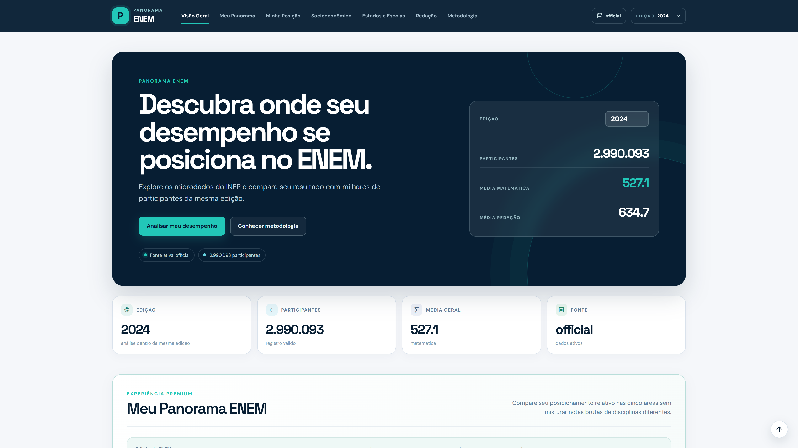

# Panorama ENEM

## Baixar e compartilhar

Este repositório reúne o código da aplicação, a documentação, os testes, os dados sintéticos de demonstração e os materiais de apresentação.

```bash
git clone https://github.com/Gstechnology18/panorama-enem.git
cd panorama-enem
```

Também é possível baixar tudo pelo botão **Code → Download ZIP**. Após extrair, abra um terminal na pasta que contém este README. Para executar localmente, tenha Python 3.12 e Node.js 22 com npm instalados, ou use Docker Compose conforme as instruções abaixo.

### Materiais de apresentação

- [Vídeo de demonstração](videos-apresentacao/panorama-enem-demonstracao.mp4)
- [Roteiro da apresentação](videos-apresentacao/roteiro-video.txt)
- [Capturas de tela em 4K](prints-apresentacao/)
- [Como rodar no Windows](COMO_RODAR_WINDOWS.txt)



Os microdados oficiais brutos e processados, as dependências instaladas e os ambientes virtuais não fazem parte do repositório. O modo de demonstração funciona com a base sintética incluída; para analisar os dados oficiais, siga a seção de processamento dos microdados.

---

Aplicação web analítica do Projeto Aplicado III — Ciência de Dados e Inteligência Artificial (SENAI/SC).

O sistema transforma os microdados oficiais do ENEM em consultas estatísticas acessíveis e personalizadas, cobrindo as edições de **2018 a 2025**. O escopo implementa os quatro módulos previstos no plano: percentil por área, recorte socioeconômico, comparação por UF/tipo de escola e posicionamento na redação.

## O que já está implementado

- ETL reprodutível para ZIP/CSV oficial do INEP, em chunks;
- contrato de dados comum 2018–2025;
- saída Parquet + ZSTD particionada por edição;
- motor analítico DuckDB para consulta direta dos Parquets;
- percentil empírico exato e z-score dentro da mesma edição;
- FastAPI com validação, CORS, OpenAPI e tratamento de erro;
- interface React/Vite responsiva e acessível;
- quatro módulos analíticos completos;
- modo demonstração que funciona sem baixar dezenas de GB;
- Docker Compose;
- testes automatizados e CI com meta mínima de 60% de cobertura;
- documentação de arquitetura, metodologia e implantação;
- base Terraform para armazenamento seguro em AWS S3.

## 1. Rodar imediatamente (modo demonstração)

### Windows PowerShell

```powershell
.\scripts\start-dev.ps1
```

Ou manualmente:

```powershell
py -3.12 -m venv .venv
.\.venv\Scripts\Activate.ps1
python -m pip install -e ".[dev]"
uvicorn app.main:app --app-dir backend --reload --port 8000
```

Em outro terminal:

```powershell
cd frontend
npm install
npm run dev
```

Acesse:

- Aplicação: `http://localhost:5173`
- Swagger da API: `http://localhost:8000/docs`

## 2. Rodar com Docker

```bash
docker compose up --build
```

Acesse `http://localhost:8080`.

## 3. Processar os microdados oficiais

Uma edição:

```bash
python -m app.etl.cli all --years 2025
```

Todas as edições do escopo:

```bash
python -m app.etl.cli all --years 2018-2025
```

O pipeline gera:

```text
backend/data/parquet/
├── ano=2018/enem.parquet
├── ano=2019/enem.parquet
├── ...
└── ano=2025/enem.parquet
```

A configuração padrão `PANORAMA_DATA_MODE=auto` detecta os Parquets e passa a usar automaticamente os microdados processados. Sem Parquet, usa o dataset sintético de demonstração.

## 4. Testes

```bash
pytest --cov=backend/app --cov-report=term-missing
```

## Estrutura

```text
backend/
  app/
    api/        # rotas REST
    core/       # config, modelos e constantes
    etl/        # download, padronização e Parquet
    services/   # motor estatístico e engines de dados
  tests/
  data/demo/
frontend/
  src/
docs/
infra/terraform/
scripts/
docker-compose.yml
```

## Limitações metodológicas

- Não há comparação de nota bruta entre edições diferentes.
- Não há previsão de aprovação ou nota futura.
- As análises são estatístico-descritivas; associação não implica causalidade.
- A aplicação é anônima e não persiste histórico individual.
- O dataset `backend/data/demo/enem_demo.csv` é sintético e serve apenas para validar funcionamento. Para resultados acadêmicos, rode o ETL sobre os microdados oficiais do INEP.
